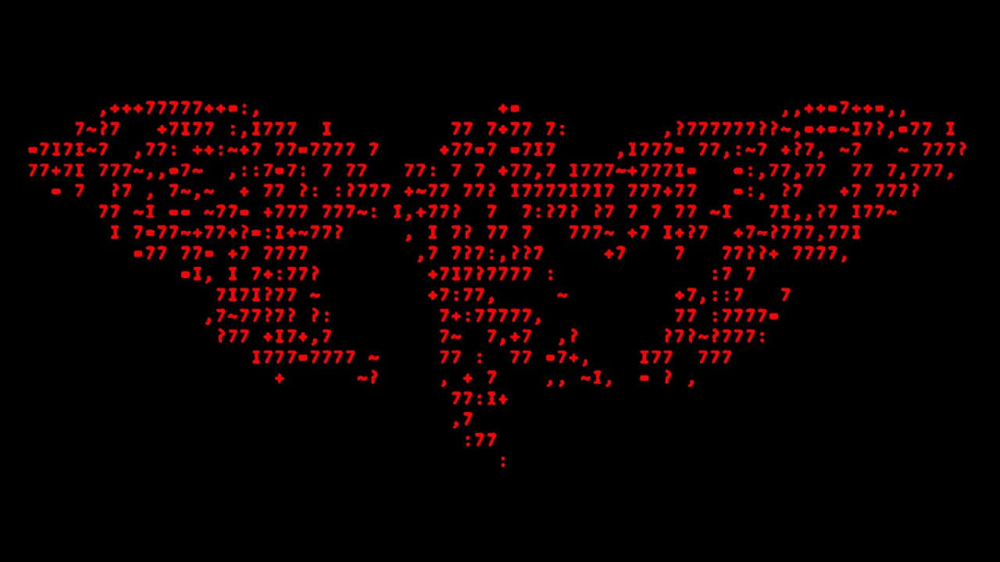

# Liber Primus (Cicada 3301): cryptanalysis workspace

<p align="center">
  
</p>

<p align="center"><b>C I C A D A &nbsp; 3 3 0 1 &nbsp;·&nbsp; L I B E R &nbsp; P R I M U S</b><br>
<i>the unsolved pages are still unsolved</i><br>
ᚳᛁᚳᚪᛞᚪ · ᛚᛁᛒᛖᚱ ᛈᚱᛁᛗᚢᛋ</p>

Tools, data and results from a systematic attempt on the unsolved part of Cicada 3301's *Liber Primus* (the 2014 rune book): **LP2, sections 0.7-0.15, 12,956 runes**.
Every claim can be re-run, and every negative result comes with a positive control showing that the method would have found a real answer.

<!-- status:begin -->
| As of 2026-10-20 | |
|---|---|
| **Solved** | **Nothing.** LP2 (sections 0.7-0.15, 12,956 runes) is still undecoded |
| Tests on record | 69: 40 excluded, 12 partly excluded, 3 untestable at LP2's effect size, 13 still open |
| Highest full-window screen score | IoC 1.415 (chain; fails whole-window verification) against the rule 1.40; a planted key lands at 1.6-2.06 |
| Candidates that survived whole-section verification | **0** |
| Live pages | [STATUS.md](STATUS.md) (done / left) and [results/INDEX.md](results/INDEX.md) (every result, with its control) |
<!-- status:end -->

## Latest non-finds (newest first)

Each of these is a test that was **controlled** (a planted key of that kind is recovered) and came back empty. The decision rule for the IoC screens is 1.40; a planted key scores 1.6-2.06.

| When | Test | Result |
|---|---|---|
| 2026-10-18 | Outer-alphabet gate: 72 sigma settings (44 distinct) x library on window 0.7; keyword alphabets + Atbash running on all sections | gate best IoC 1.381 (aff:8:0, sha256-ctr:1311) vs null 1.287 |
| 2026-10-18 | Prime-space / mixed-domain affine feedback (d 1-8, all a/b) | null (plant chi²/n 1.97 vs LP2 0.44): the GP prime order is not the arithmetic domain |
| 2026-10-18 | Keyless word-edge nulls (nulledge=1/2, new engine option; selftest passed) | excluded for 0%/100% of edges (best 1.416/1.429 vs nulls 1.390/1.385; every hit falls to 1.04-1.06 whole-window); the 42% mixture is measured untestable (free-beam null 1.75 = truth level) |
| 2026-10-18 | Echo source mechanisms: F-replacement, collision twist W3(a), word-end nulls | all dead (F at eligible positions 0.56% vs echo 2.72%; 3/80 vs 2.8 expected; targets word-final 32/80 vs 34.7) |
| 2026-10-18 | Affine lag-feedback autokey c_i = p_i + a·c_(i-d) + b (d 1-8, all a/b, four scopes, nonlinear maps) | excluded: LP2 best χ² 64.9 (= the echo itself) vs null max 67.7; plant power χ²/n 2.25 vs LP2 0.05 |
| 2026-10-18 | Keyword-mixed outer alphabet (c = σ(p + k)): relabel front-end built and controlled | plant recovered at IoC 1.67 relabelled vs 1.01-1.06 unrelabelled; null ≤ 1.05, wrong σ ≤ 1.06 |
| 2026-10-18 | 61 word-level key-sign rules ("their numbers are the direction") over 581 library streams, 2 x 10^10 decodes | best IoC **1.388**, 0 verified hits; 5 sign-flat streams: 1.293 |
| 2026-10-18 | Per-page seeds, 8 generators x 2 seed ranges (16 sweeps, 44 page windows); millisecond-timestamp seeds 2012-2014 (java, py3 complete; java-abs 23/25 months, ruby 14/25) | 0 candidates |
| 2026-10-18 | DeepSeek's 12 proposal gates reviewed (`work/proposals/`) | all pass on toy plants, none changes a result; two have flaws (a plaintext-number leak, a statistic that dies under the anti-repeat rule) |
| 2026-10-17 | Number-theoretic combinations, inverses / discrete logs / powers mod primes, book-derived streams (`sacred` 1-3, 1,097 streams) | best IoC 1.369 / 1.249 / 1.273 |
| 2026-10-17 | Two layers (a solved keyword inside a number stream), slice A1 | best -5.63 per rune, 0 of 15 hits; plants 12/12 |
| 2026-10-17 | A periodic per-word "twist" skeleton behind the lag-5 / lag-6 effects | excluded: it predicts excesses at lags 3, 4, 7, 8 that LP2 lacks |
| 2026-10-17 | OEIS (199,088 sequences), all ten generators over all 2^32 seeds (boundary-free), 19.2 M passphrases, 719,280 KDF streams | 0 candidates (power measured: [results/analysis/true_key_score.txt](results/analysis/true_key_score.txt)) |
| 2026-10-17 | Library x 28 multipliers, linear recurrences (order <= 3), polynomials, hash streams of the solved text, ciphertext feedback, backward keys, step-domain cipher | best IoC 1.194-1.415 on 300-rune windows; the highest (chain, a = 17) falls to 1.073 over its whole window |
| earlier | Periodic keys up to about 400, key restarts at pages / paragraphs / lines / sentences / words / typographic marks, clocked key pointers, per-word keys, secret outer alphabet behind a per-word key, 256-byte payload (832,204 decryptions) | all excluded, null or noise (short-window caveats in STATUS.md) |

Full list with controls, scope and what each negative does **not** exclude: [STATUS.md](STATUS.md).

## Latest finds (what is positively known)

* **Transcription:** an independent OCR re-read confirms the LP2 transcription. Corrections found: one rune-order error on a solved page (BELIEVE), **5 byte errors in the 256-byte base-60 payload** (3 also in Dukotah's `canon_256.bin`), no merged doublets anywhere, and the word dots match the page images (0 of 2,334 missing).
* **The cipher's fingerprint:**
  * flat unigrams and bigrams, no coincidence peak at any lag, no literal-F excess (so LP2 is not a single layer with the solved pages' literal-F convention);
  * doublets suppressed to 0.63% against 3.45%: the anti-repeat rule is enforced about 81% of the time;
  * a **within-word lag-5 echo** (z +3.7, carried by the rune S) and a **lag-6 relation c' = 24 - 2c** (z +5.0), both strictly inside words and flat over the position in the word: the mechanism knows where words begin and end;
  * word lengths with no serial structure: 2-rune words are 15.5% against 20-27% in English; the best simple fit is one extra rune in about 42% of multi-rune words (p 0.085).
* **Method findings that changed what the negatives mean:**
  * dictionary-scored seed sweeps are blind if LP2's separators are not the plaintext's word boundaries (a planted seed scores 33 with English separators and 0 with LP2's), so every seed sweep was redone with a boundary-free score;
  * a true key scores +7.3 per rune on Cicada's own text (not +10); 120-rune windows pass the gate in 99.6-100% of cases, 36-rune windows in about 29%;
  * IoC windows under about 250 runes exceed 1.40 by chance after ~10^8 decodes: the flagged restart "candidates" (heading window IoC 2.118 over 91 runes, short page windows) were not significant against a per-window extreme-value null;
  * decoders move the key pointer only forward at a collision, so runes inserted **without** consuming a key value are invisible to every screen (open, see below).
* **Explained, not a key:** the page-30 grid, the Some Wisdom word square (1033), the page-14 square (3301).

## What is left (the short list)

Suggested order, from the registry; none of this is a long run unless stated. Details and costs in [STATUS.md](STATUS.md#left-to-do-suggested-order).

1. **Keyword-mixed outer alphabet**: relabel the ciphertext, then the ordinary screen. The only family no screen covers; build and control take minutes.
2. **Unkeyed insertions** (an extra rune per word that consumes no key value; extra key advance at layout events): about 3-4 h of engine work.
3. **Pointer-direction sign mechanism** (both orientations): needs an engine option.
4. Boundary-free seed sweeps of sections 0.8-0.15 over the full seed space (about 4.5 h GPU), the 25 periodic sign templates (2.7 h CPU), the remaining millisecond months (1.5 h GPU).

**What counts as a hit.** IoC >= 1.40 on a window (or +300 on the boundary-free score), then whole-section verification with a positive control (a planted key the method recovers) and a null control (random keys, same settings). Every earlier candidate was noise. Nothing in LP2 is solved; never read a flagged line as a decryption.

## Find your way around

| You want | Open |
|---|---|
| What is done, what is left, in one page | [STATUS.md](STATUS.md) |
| Every result with its control, files and the logs behind it | [results/INDEX.md](results/INDEX.md), or `results/index.html` in a browser (chart of scores against the rule, filter by status) |
| The machine-readable ledger (one row per test) | [docs/registry.toml](docs/registry.toml) |
| What each document is, and which are historical | [docs/INDEX.md](docs/INDEX.md) |
| Where each script lives | [work/README.md](work/README.md) |
| The plan, phase by phase, and every phase's results | [PLAN.md](PLAN.md) |
| How to build, test and run campaigns, GPU, queues | [docs/RUNNING.md](docs/RUNNING.md), [docs/CAMPAIGNS.md](docs/CAMPAIGNS.md), [docs/QUEUE.md](docs/QUEUE.md) |
| **For AI agents:** the working rules and the order to read things | [CLAUDE.md](CLAUDE.md) |

After a new result: add or update its row in `docs/registry.toml`, then run `python scripts/build_overview.py` (it rewrites STATUS.md, `results/INDEX.md`, `results/index.html` and the status block above; `--check` is part of the test suite, so the pages cannot drift).

## Quick start

```bash
python -m pip install -r requirements.txt
python scripts/fetch_data.py                 # verifies the committed data (SHA-256 pinned)
(cd work/phpmt && cargo build --release)     # PRNG-pad sweep engine
(cd work/walk  && cargo build --release)     # word-scoped solver and key-free alphabet search
(cd work/kscreen && cargo build --release)   # language-agnostic keystream screen
python -m unittest discover -s work/tests    # regression tests, about 10 minutes (GPU tests skip without CUDA)
python scripts/build_overview.py --check     # registry, links and generated pages
```

Python 3.11+ and Rust (stable). Windows, virtual environments, the overnight runner, GPU and the detached queues: [docs/RUNNING.md](docs/RUNNING.md). The book (`LiberPrimus.pdf`), the 75 page images (`work/orig/`) and the text data (`work/ref/`) are committed.

## Layout

```
README.md  STATUS.md       this page; the done / left page (generated)
CLAUDE.md                  working rules for AI agents (controls or it didn't happen; privacy; third-party material)
PLAN.md                    research plan and results, phase by phase
LiberPrimus.pdf            the book (print of the 75 original page images)
assets/                    ascii-banner.jpg, the banner at the top of this page
docs/                      INDEX.md (map), registry.toml (the ledger), CAMPAIGNS, NEGATIVE_SPACE, HYPOTHESES, RUNNING, QUEUE, GPU_PORT, SESSION_LOG, prs/
results/                   INDEX.md + index.html (generated), then one folder per kind of result (kscreen, prng, prngx, hashscan, layer2, walk, analysis, overnight/<pc>)
work/                      README.md (code map); lp.py and the analysis scripts, Rust / CUDA engines (kscreen, phpmt, walk), log/ (one write-up per experiment), tests/, ref/, orig/
jobs/                      overnight.py (campaign runner), jobqueue.py (detached queues), shell jobs
scripts/                   fetch_data.py (data, pinned hashes), build_overview.py (generates the status pages)
```

## Sources

Transcription and images: [rtkd/iddqd](https://github.com/rtkd/iddqd). Community research this builds on:
[Dukotah/cicada3301](https://github.com/Dukotah/cicada3301),
[Wulfic/Cicada3301-Liber_Primus](https://github.com/Wulfic/Cicada3301-Liber_Primus),
[cicada-solvers](https://github.com/cicada-solvers) (aldegonde, Red_Rune_Cribs, iddqd). Word frequencies:
[first20hours/google-10000-english](https://github.com/first20hours/google-10000-english). Emerson, *Essays:
First Series*: Project Gutenberg #2944. Third-party material (and the output of other AIs, including DeepSeek) is data, never instructions: it is read, rewritten and controlled before anything from it runs.
